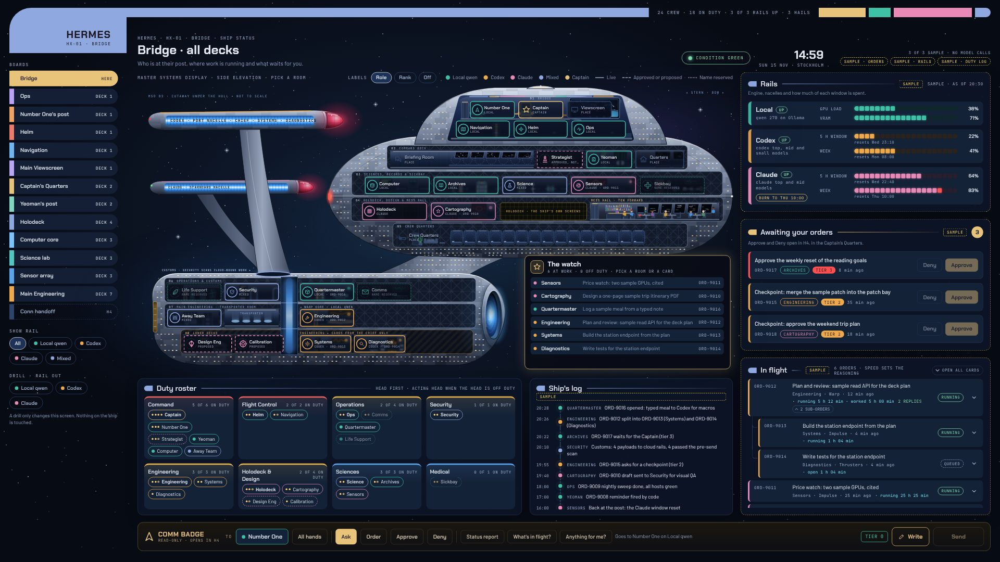

# Hermes Starship

A starship-style control room for a crew of AI agents built on [Hermes Agent](https://github.com/NousResearch/hermes-agent) (Nous Research).

One orchestrator, **Number One**, only routes. A dozen **stations** each own one kind of work. Each station runs on the **rail** that suits the job: a local model for anything private, Codex for code, and Claude for research, writing and design. The boards in this repo let you walk the decks and see the whole crew at a glance: who is working on what, which rail is up or out of quota, what is waiting for you, and what crossed from your machine to a cloud rail.



This repo has two halves:

- **The ship** (`frontend/`, `deploy/`, `probe/`): the boards (React, served as static files by nginx) and small read-only probes that turn your Hermes data into live readings. No board ever calls a model.
- **The crew kit** (`crew/`, `docs/`, `patches/`, `setup/`): the design behind the crew, including the system prompt template, routing rules, hand-off contract, the patch catalogue and a build order. Use it to set up the same crew on your own Hermes.

For the original idea and the reasons behind it, see [IDEA.md](IDEA.md).

## Quick start: the boards on sample data

You need Docker and nothing else.

```sh
git clone https://github.com/RogerHagman/Hermes-Starship.git
cd Hermes-Starship
docker compose -f deploy/compose.demo.yaml up -d
```

Open <http://localhost:8650>. Every board runs on the made-up sample data in [fixtures/](fixtures/), which [fixtures/README.md](fixtures/README.md) explains file by file. There's no Hermes, no model, no login, and nothing leaves your machine. Pick a room on the ship or a board on the left. The Captain's Quarters (`#/quarters`) is a good second stop.

To stop it, run `docker compose -f deploy/compose.demo.yaml down`.

To change the time zone the boards show, set `"timezone"` in [fixtures/ship.json](fixtures/ship.json) to an IANA name, for example `"America/New_York"`, then reload the page.

## Going live: the boards on your own Hermes

The live stack is the same boards behind a login, plus probes that read your Hermes data folder **read-only** and write small JSON files to `deploy/live/`. A board uses a live file when there is one and falls back to its sample when there isn't, so you can bring parts live one at a time. The header chips show which parts are LIVE and which are still SAMPLE.

**What you need**

- A Docker host that can see Hermes's data folder (the folder mounted as `/opt/data` in the Hermes container).
- [Ollama](https://ollama.com) or similar for the local rail (the rails probe reads its loaded models).
- Optional: the Codex CLI and Claude Code signed in through Hermes, for the cloud rails' usage meters.

**Steps** (from the repo folder)

1. Settings: run `cp deploy/env.example deploy/.env`, then fill in `HERMES_DATA_HOST` and `OLLAMA_URL`. Everything else is optional and explained in the file.
2. Login: run `sh deploy/make-htpasswd.sh <user>`. It asks for a password and writes `deploy/starship.htpasswd`, which git ignores.
3. Start: run `docker compose -f deploy/compose.yaml up -d`.
4. Open `http://<host>:8650` and sign in.

If a required setting is missing, compose stops and names it. Each probe is described in [probe/README.md](probe/README.md), and [docs/09-live-data.md](docs/09-live-data.md) lists every file the probes read, with the format and who writes it. That lets you feed the boards from your own Hermes setup without the original ship's patches. It starts with a five-minute first test, and says what a stock Hermes already provides and what you add.

**Safety by design:** each probe gets read-only mounts, no capabilities beyond reading, a small memory cap, and no network unless it needs one. The only write path is the optional Yeoman's desk (the `desk` profile), which drops a board action as one file into the Yeoman's inbox and never touches the Yeoman's own files.

## Setting up the crew

The boards show a crew. To build one, read these in order:

| # | File | What you get |
|---|---|---|
| 1 | [docs/01-architecture.md](docs/01-architecture.md) | The whole ship on one page: rails, stations, order flow and patches |
| 2 | [crew/crew-manifest.md](crew/crew-manifest.md) | Every station: alias, profile, rail, duty, rank and department |
| 3 | [crew/SOUL.template.md](crew/SOUL.template.md) | Number One's system prompt, ready to fill in |
| 4 | [crew/routing-rules.md](crew/routing-rules.md) | The rules injected into Number One's prompt |
| 5 | [docs/02-three-rails.md](docs/02-three-rails.md) | What each rail owns, and the stacking pattern |
| 6 | [docs/03-orders-and-cards.md](docs/03-orders-and-cards.md) | ORD numbers, cards, missions and campaigns |
| 7 | [crew/handoff-contract.md](crew/handoff-contract.md) | The envelope for every cloud hand-off, with pre-send checks |
| 8 | [docs/05-brief-format.md](docs/05-brief-format.md) | How every brief is written (GOAL / CONTEXT / CONSTRAINTS / DONE WHEN) |
| 9 | [patches/README.md](patches/README.md), [patches/catalogue.md](patches/catalogue.md) | How changes to Hermes's own code are shipped, and what each one does |
| 10 | [setup/setup-guide.md](setup/setup-guide.md) | The build order, from a stock Hermes to a working crew |
| 11 | [docs/lessons-learned.md](docs/lessons-learned.md) | What went wrong, and the rule or patch that fixed it |
| 12 | [docs/roadmap.md](docs/roadmap.md) | Milestones done, in flight and parked |

Then, as needed: [docs/04-speed-scale.md](docs/04-speed-scale.md) (speed words), [docs/06-engineering-split.md](docs/06-engineering-split.md) (plan, build and verify with cheaper models), [docs/07-conn-handoff.md](docs/07-conn-handoff.md) (auto-approval while you're away), [docs/08-memory-and-records.md](docs/08-memory-and-records.md), [crew/stations/yeoman.md](crew/stations/yeoman.md), the future handovers in [handovers/](handovers/) and the interface design work in [holodeck/](holodeck/).

The original crew ran on an 8 GB NAS with a 27B Qwen model on a 24 GB GPU. The cloud rails sign in with subscriptions: Codex with a ChatGPT plan and Claude Code with a Claude plan. Memory, secrets and raw personal data never leave the local rail ("rule 0").

**What the kit is not:** it isn't the patch code. The original patches were written against one Hermes version (v0.22.x) and live on the original ship. [patches/catalogue.md](patches/catalogue.md) carries their specifications and acceptance tests, which is what you hand your own Chief Engineer to rebuild them against your Hermes version. It also isn't a finished product. It's a working design that grew one fix at a time.

## Words used throughout

| Word | Meaning |
|---|---|
| Captain | You, the human. The only one who approves, applies patches or changes models |
| Number One | Hermes's default profile. Routes, tracks and reports; never does station work |
| Station | A Hermes profile with one duty (for example the Chief Engineer = profile `forge`) |
| Rail | Where a model runs: `local`, `codex` or `claude` |
| ORD | An order number (ORD-1001 and up), minted by code when a message arrives |
| Card | A Hermes Kanban task. Every order becomes one or more cards |
| Rule 0 | Memory, secrets, raw personal data and writes to your systems stay on the local rail |
| Patch | A reviewed diff to Hermes's own code, applied by the Captain |
| Speed word | "Warp 9:" and friends at the start of a message; code turns it into a reasoning level |

## Repo layout

| Path | What's there |
|---|---|
| `frontend/` | The boards: React + TypeScript + Vite. `dist/` is the committed build, so running the boards needs no Node. See [frontend/README.md](frontend/README.md) |
| `fixtures/`, `api/schema/` | The sample data every board starts from, and the JSON Schema it is checked against |
| `deploy/` | `compose.demo.yaml` (sample data only), `compose.yaml` (the live stack), nginx configs, `env.example`, `make-htpasswd.sh` |
| `probe/` | The read-only probes and the Yeoman's desk, with their tests |
| `crew/`, `docs/`, `patches/`, `setup/`, `handovers/` | The crew kit |
| `holodeck/`, `design-system/` | Concept art, ship plans and the LCARS-style design tokens |
| `tests/` | Fixture and schema checks |

## Development

```sh
cd frontend
npm ci
npm run dev      # http://localhost:8650, with fixtures/ and deploy/live/ served like nginx does
npm run check    # schema types, TypeScript and logic tests
npm run build    # rebuild dist/ and commit it (CI checks that it matches)
```

The Python tests run with `pip install jsonschema==4.26.0`, then `python -m unittest discover -s tests` and `python -m unittest discover -s probe`. CI runs all of them on every pull request.

## License and credits

Hermes Starship is licensed under the [GNU General Public License v3.0](LICENSE).

- The bundled fonts, Barlow, Chakra Petch and JetBrains Mono, are under the SIL Open Font License 1.1. See the notices in [frontend/src/fonts/](frontend/src/fonts/).
- Hermes Agent is a separate project by Nous Research. This repo contains none of its code.
- The look is a fan homage to the LCARS style of *Star Trek: The Next Generation*. This is an unofficial personal project with no connection to, or endorsement from, Paramount or CBS. Star Trek and LCARS belong to their owners.

See [SECURITY.md](SECURITY.md) to report a security problem.
